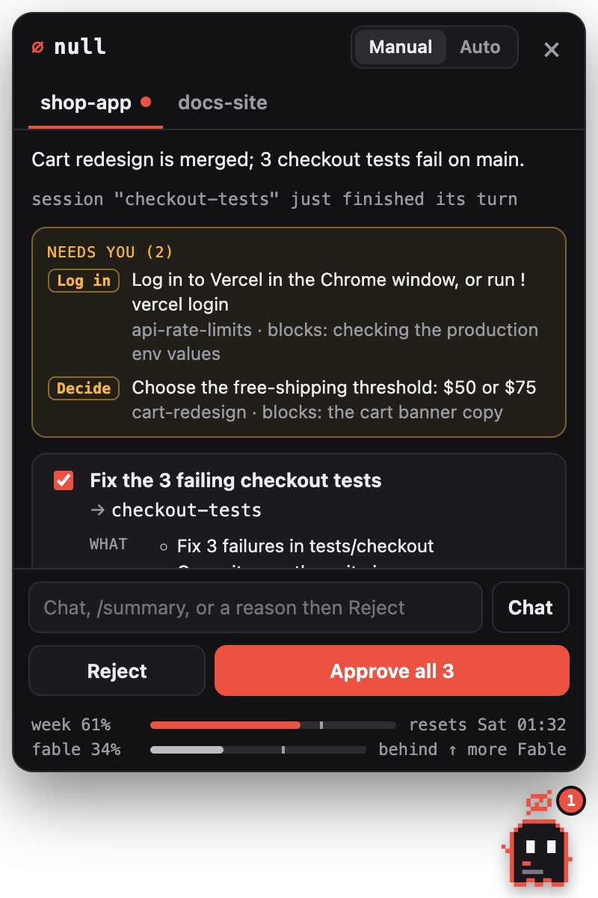
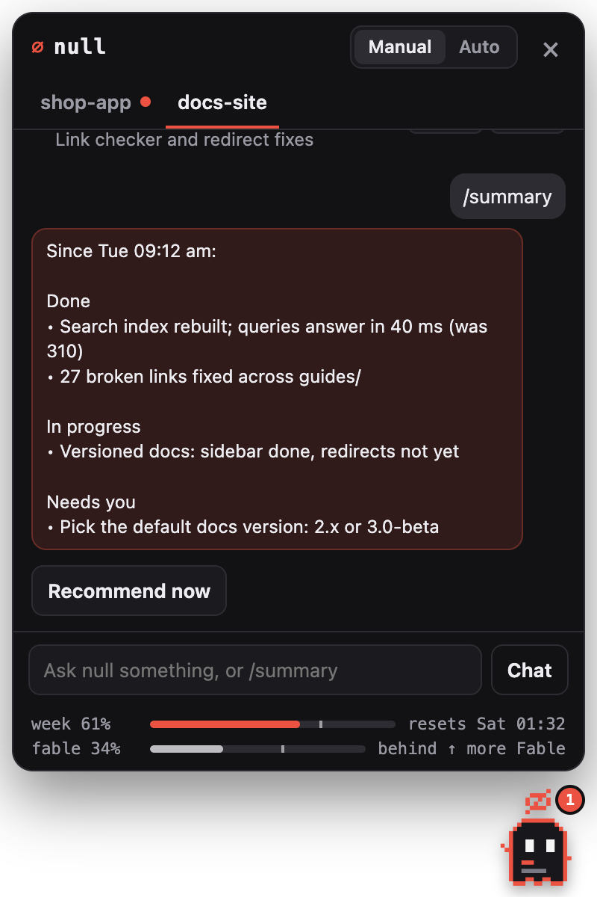
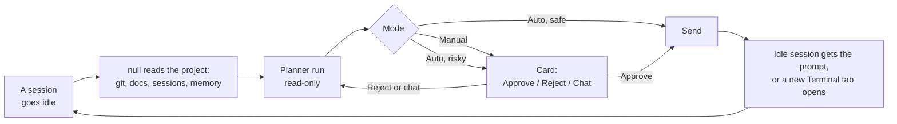
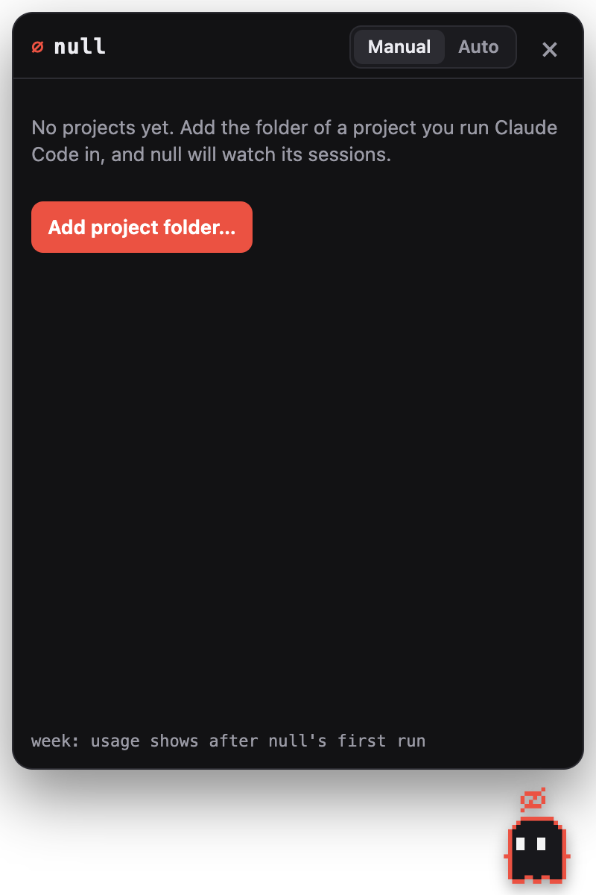
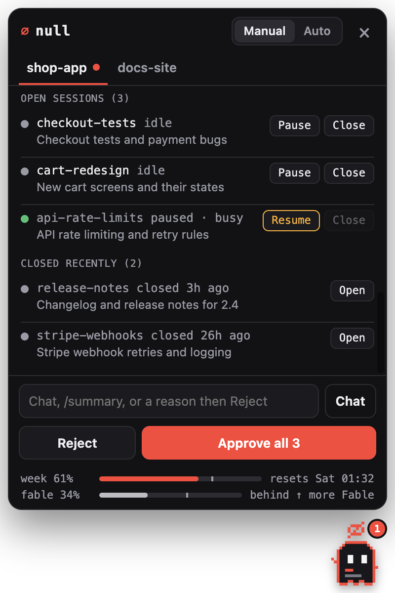

# null

A small desktop pet for macOS that keeps [Claude Code](https://claude.com/claude-code) busy.

Most of a weekly Claude allowance goes unused because sessions sit idle after they finish a turn. null watches the Claude Code sessions on your projects. When one goes idle, it reads where the project stands and recommends the next pieces of work. You approve, reject or chat about them, or switch on auto mode and let null hand the work out itself.

<p>
  
  
</p>

## What it does

- **Watches your sessions.** It knows every Claude Code session in each project folder you add, open or recently closed, whether each is busy or idle, and what each one is for.
- **Close, Open, Pause.** Close an idle session (its tab too), reopen a closed one with its history, or pause one so null sends it nothing.
- **Shows what needs you.** Logins, decisions and questions that sessions are waiting on are listed at the top of the card, with the session that asked.
- **Recommends the next step.** When a session finishes, null looks at git, the project's docs and what each session last did, then proposes up to three actions. Each has short **What** and **Why** bullets and the full prompt it would send.
- **Three choices per card.** Approve (all or some), Reject (with a reason, and null proposes something else), or chat about it.
- **Uses the sessions you already have.** Work goes to idle sessions first, so they keep their context. null opens a new Terminal tab only when no idle session fits.
- **Auto mode.** Runs safe actions without asking. Anything risky still asks: production, deploys, migrations, deletes, pushes, sends.
- **One memory per project.** Goals, decisions and rejected ideas are kept separately for each project and never mixed.
- **`/summary`.** Type it in the chat box to get what changed in that project since you last asked.
- **Usage meters.** Shows how much of the week's allowance is used against an even pace.

## How it works



null runs Claude Code itself for two small jobs, both under your own login:

- **The planner** is a headless `claude -p` run limited to read-only tools (`Read`, `Grep`, `Glob` and a few `git` commands). It cannot edit anything.
- **The courier** is a short headless run that can only list sessions and send a message. It delivers an approved prompt to an idle session, which runs it as a normal turn.

Your Claude Code settings, plugins and hooks apply to these runs and to the sessions null starts, the same as to your own.

## Requirements

- **macOS.** null uses Terminal.app to open new sessions and a LaunchAgent to start at login.
- **Node.js 20 or later.**
- **Claude Code**, installed and logged in (`claude` on your `PATH`). Tested with 2.1.327. null relies on session status files in `~/.claude/sessions` and on messaging between sessions, so older versions may not work.
- A Claude plan with a weekly allowance. Every recommendation is a Claude Code run that uses it.

## Getting started

### 1. Install

```sh
git clone https://github.com/khansa-aaa/null-pet.git
cd null-pet
npm install
```

### 2. Optional: choose the sprite

null ships with its own pixel-art pet. To use a different one, see [The sprite](#the-sprite); do it now, before the first start, and null shows it from the first launch.

### 3. Start

```sh
npm start
```

The pet appears in the bottom-right corner of your screen, and a small icon appears in the menu bar. To keep it running after you close the terminal:

```sh
nohup npm start >/dev/null 2>&1 &
```

### 4. Add a project

Click the pet. The first time, the card has one button:



Choose the folder of a project you run Claude Code in. Sessions started in that folder or any folder inside it count as that project's. Add more from the menu: right-click the pet, then **Projects › Add project folder…**

### 5. Open Claude Code sessions as usual

Start `claude` in the project folder in as many Terminal tabs as you like. null picks them up within a few seconds. Naming them helps you read the cards:

```sh
claude -n checkout-tests
```

### 6. Decide on the first card

null plans once when a project is added and again each time one of its sessions finishes a turn. Planning takes one to four minutes; the pet shows a thinking animation meanwhile. Then the card opens:

| Control | What it does |
| --- | --- |
| Checkboxes | Choose which actions to run |
| **Approve** | Sends each chosen prompt to its session |
| **Reject** | Records the rejection (type a reason first if you have one) and asks for a different plan |
| **Chat** | Talk to null about the plan; it answers and revises the card |
| **Prompt** | Unfolds the exact text a session would receive |

To ask for a plan at any time, use **Recommend now** on the card or in the menu.

### 7. Optional: turn on auto mode

Use the **Manual / Auto** switch at the top of the card.

- **Manual** asks before running anything.
- **Auto** sends safe actions straight away and tells you with a notification. Risky actions still show a card.

Auto mode stops by itself when you are rate limited, when the week's allowance passes 95% (`week_cap`), or after 12 sends for one project in an hour.

### 8. Optional: start at login

Right-click the pet and tick **Start null at login**.

## Using null

| Action | How |
| --- | --- |
| Open or close the card | Click the pet |
| Move the pet | Drag it |
| Menu | Right-click the pet, or click the menu bar icon |
| Summary of changes | Type `/summary` in the chat box |
| Ask for something specific | Type it in the chat box; null plans around it |
| Pause everything | Menu › **Pause null** |
| Stop watching a project | Menu › **Projects** › the project › untick **Watch this project** |

### Sessions

Open **Sessions** at the bottom of a card (it is always shown when no card is waiting). Each session has a one-line purpose that null writes from its prompts, and three controls:



| Button | What it does |
| --- | --- |
| **Close** | Ends an idle session and closes its Terminal tab. Its history stays on disk. Not offered while a session is working |
| **Open** | Reopens a session closed in the last 7 days, in a new Terminal tab, with its history (`claude --resume`) |
| **Pause** / **Resume** | A paused session stays open, but null plans nothing for it and sends it nothing |

### Needs you

Sessions often finish a task by asking you for something: a login, a decision, an answer, a purchase. Those asks appear at the top of the card, each with the session that asked and what stays stuck until you act. To answer one, do it (log in, run the command), or type your answer in the chat box and null passes it on in its next plan.

### `/summary`

Each project has its own summary. It covers everything since your last `/summary` (the first one covers the past day): commits, uncommitted files, what each session did (including sessions you have since closed), and what null sent or you rejected. The answer is three short lists: **Done**, **In progress** and **Needs you**.

### What counts as risky

null asks before any action that mentions production, deploys, migrations, access rules, secrets, releases, deleting data, `git push`, force-pushes, `rm -rf`, payments, or sending emails and messages. The planner can also flag an action itself. The check is a word list in [`src/risk.js`](src/risk.js), so read the prompt before you approve: it is a safety net, not a guarantee.

### Usage meters

The bar at the bottom of the card shows the share of your weekly allowance used. The small mark shows where an even pace would be: left of the mark means you have room to run more.

Some plans have a second, separate weekly limit for the most capable model. Claude Code reports it only on replies that model wrote. When null sees it, a second bar appears and shows whether that limit is behind or ahead of the weekly one. null also writes both readings to `~/.claude/fable-meter.json`, so a hook or plugin of your own can steer more work to that model when it is behind:

```json
{
  "fable": { "used": 34, "resetsAt": 1795255200, "at": 1794978696382 },
  "week": { "used": 61, "resetsAt": 1795255200, "at": 1794978696382 }
}
```

`used` is a percentage and `resetsAt` is in epoch seconds. This part depends on undocumented Claude Code output and may change.

## Settings

Settings live in `~/Library/Application Support/null-pet/settings.json`. Quit null before editing the file.

| Key | Default | Meaning |
| --- | --- | --- |
| `mode` | `"manual"` | `"manual"` or `"auto"` |
| `paused` | `false` | Stops planning and auto-sending |
| `projects` | `[]` | `{ id, name, root, enabled }` for each project |
| `idle_debounce_s` | `20` | How long a session must stay idle before null plans |
| `max_busy_per_project` | `4` | null won't open new sessions past this many busy ones |
| `week_cap` | `0.95` | Auto mode stops sending above this share of the week |
| `courier_permission_mode` | `"auto"` | The permission mode your own sessions run in. If it differs, sessions hold null's messages until you approve them there |

Environment variables for development: `NULL_PET_DATA` (data folder), `NULL_PET_CLAUDE_DIR` (instead of `~/.claude`), `NULL_PET_NO_STARTUP_PLAN=1` (don't plan at launch).

## Where things are kept

Everything is local, under `~/Library/Application Support/null-pet/`:

| Path | Contents |
| --- | --- |
| `settings.json` | Settings |
| `null.log` | What null did, and which model each run used |
| `projects/<id>/memory.md` | That project's goals, decisions and rejected ideas |
| `projects/<id>/history.jsonl` | Recommendations, sends and decisions |
| `projects/<id>/roster.json` | Session names, purposes and which are paused |
| `projects/<id>/prompts/` | Prompts given to new sessions |

**Privacy.** null has no server and sends nothing anywhere itself. To plan, it gives Claude Code a brief of the project: branch, changed file names, recent commit subjects, doc headings, and the last prompt and reply of each session in that project. The planner can also read files in the project folder. That goes to Anthropic through your own Claude Code login, like any other Claude Code run.

## The sprite

The built-in sprite is original pixel art, generated by [`scripts/make-sprite.js`](scripts/make-sprite.js). Change the script and run `npm run sprite:build` to redraw it.


The sheet uses the Codex pet layout (8 columns by 11 rows of 192×208 frames), so any sheet in that layout works. Put yours at `assets/custom/sprite.webp` or `assets/custom/sprite.png` (create the `custom` folder first); that folder is ignored by git. A 64×64 `assets/custom/tray.png` replaces the menu-bar icon too. null picks the sprite up when it starts, so if null is already running, quit it and start it again.

If you have the ChatGPT or Codex desktop app installed, you can use one of its pets, such as the original "null", on your own Mac:

```sh
npm run sprite:codex              # the "null" pet
npm run sprite:codex -- --list    # see which pets your app has
npm run sprite:default            # back to the built-in sprite
```

These need the ChatGPT desktop app for Mac (a free download from openai.com) installed; signing in isn't needed.

That art belongs to OpenAI. The script copies it from your own installation and it is not part of this repository.

## Troubleshooting

| Problem | Fix |
| --- | --- |
| "Claude Code is not installed or not on the PATH" | Check that `claude --version` works in a new Terminal window |
| No sessions listed | Sessions must be started inside a project folder you added. Check `ls ~/.claude/sessions` |
| A session shows the message but waits for approval | Set `courier_permission_mode` to the mode your sessions use |
| New sessions open in a window, not a tab | Allow Electron under System Settings › Privacy & Security › Accessibility. Without it null opens a window, so it can never type into the wrong tab |
| Planning failed | Menu › **Open log** shows the error. A run times out after 8 minutes |
| The pet is off screen | Menu bar icon › **Reset position** |

## Development

```sh
npm test    # unit tests (node --test)
```

| File | Job |
| --- | --- |
| `main.js` | Window, tray, menu, notifications |
| `src/sessions.js` | Watches `~/.claude/sessions` and groups sessions by project |
| `src/snapshot.js` | Builds the project brief for the planner |
| `src/planner.js` | The read-only planner run and its output format |
| `src/brain.js` | The loop: idle, plan, card or auto-send |
| `src/dispatch.js` | The courier, and opening new Terminal sessions |
| `src/risk.js` | Which actions always ask |
| `src/memory.js` | Per-project memory and history |
| `src/summary.js` | `/summary` |
| `src/roster.js` | Open and closed sessions, their purposes, pausing |
| `src/usage.js` | Usage meters |
| `ui/` | The pet and the card |

The screenshots in this README are made with invented data: `NULL_PET_SNAPSHOT=/tmp/null-shots npm start` writes them to that folder and touches nothing else.

## Notes

null is a personal project. It is not affiliated with or endorsed by Anthropic or OpenAI. It sends prompts to your Claude Code sessions on your behalf, so start in manual mode and read what it proposes.

## License

[MIT](LICENSE)
